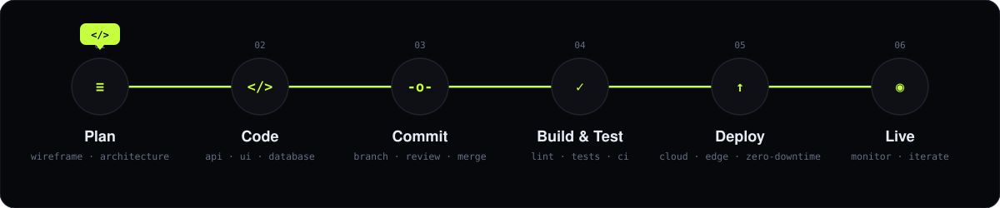
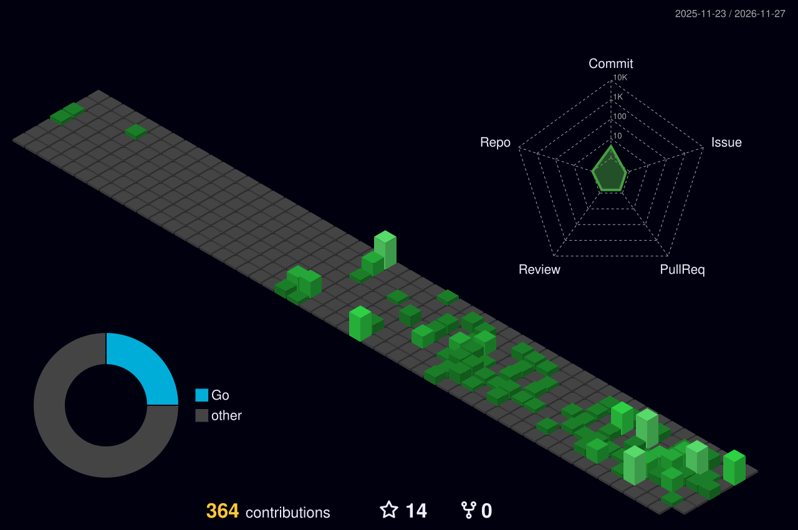

<!-- Generated to match portfolio-giv.vercel.app (midnight + lime). Light/dark switch automatically with your GitHub theme. -->

<picture>
  <source media="(prefers-color-scheme: dark)" srcset="assets/header-dark.svg" />
  <source media="(prefers-color-scheme: light)" srcset="assets/header-light.svg" />
  
</picture>

  
  
  
  

### `01` — About

Results-driven **Software Engineer & Full Stack Developer** from Surabaya, building web applications, business systems and AI-assisted features **end to end** — from requirements and architecture to deployment.

- ⚡ **3+ years** shipping finance, logistics, HR and retail systems for companies and SMEs
- 🚀 Cut data loading time by **up to 50%** at SPIL through Golang API and SQL optimisation
- 🧩 Led the migration of a Java desktop app to a modern web platform
- 🎓 B.Sc. Information Systems, Universitas Dinamika — **Cum Laude** (3.63/4.00)
- 💬 Open to **freelance & full-time** — prices are negotiable, [let's talk](https://portfolio-giv.vercel.app/#contact)

### `02` — How I work

<picture>
  <source media="(prefers-color-scheme: dark)" srcset="assets/workflow-dark.svg" />
  <source media="(prefers-color-scheme: light)" srcset="assets/workflow-light.svg" />
  
</picture>

### `03` — Tech stack

**Backend** &nbsp;
    

**Frontend** &nbsp;
      

**Database** &nbsp;
  

**Tools** &nbsp;
   

### `04` — Selected work

| Project | What it does | Stack |
|---|---|---|
| **Integrated Logistics System** | Shipping, cargo tracking & inventory flowing straight into accounting with automated journals | Laravel · Golang · MySQL |
| **Finance Application** | Transactions, journal entries, reconciliation and management reports | Golang REST API · SQL |
| **Logistics API modernisation (SPIL)** | Refactored Golang APIs and SQL — data loads up to 50% faster | Golang · JSP · AJAX · MySQL |
| **HRIS for an SME** | Employees, attendance, leave, payroll support and recruitment, built in ~1 month | PHP · Bootstrap · MySQL |
| **Phone Store Management System** | POS, inventory and profit & loss reports | Vue.js · Laravel |
| **Nutrimenu** | Meal planning for nutrition clinics with calorie & nutrient calculation | Web app |

<a href="https://portfolio-giv.vercel.app/#projects">→ See case studies, screenshots and live demos on the portfolio</a>

### `05` — GitHub activity

<picture>
  <source media="(prefers-color-scheme: dark)" srcset="profile-3d-contrib/profile-night-green.svg" />
  <source media="(prefers-color-scheme: light)" srcset="profile-3d-contrib/profile-green-animate.svg" />
  
</picture>

<picture>
  <source media="(prefers-color-scheme: dark)" srcset="https://raw.githubusercontent.com/alvansyah-prog/alvansyah-prog/output/snake-dark.svg" />
  <source media="(prefers-color-scheme: light)" srcset="https://raw.githubusercontent.com/alvansyah-prog/alvansyah-prog/output/snake-light.svg" />
  
</picture>

  <picture>
  <source media="(prefers-color-scheme: dark)" srcset="https://github-readme-stats.vercel.app/api?username=alvansyah-prog&show_icons=true&hide_rank=false&border_radius=14&include_all_commits=true&count_private=true&bg_color=07080c&title_color=c6ff3d&text_color=e8ecf4&icon_color=c6ff3d&border_color=1e222c" />
  <source media="(prefers-color-scheme: light)" srcset="https://github-readme-stats.vercel.app/api?username=alvansyah-prog&show_icons=true&hide_rank=false&border_radius=14&include_all_commits=true&count_private=true&bg_color=ffffff&title_color=4d7c0f&text_color=0b0d12&icon_color=4d7c0f&border_color=d9dee7" />
  
</picture>
  <picture>
  <source media="(prefers-color-scheme: dark)" srcset="https://github-readme-stats.vercel.app/api/top-langs/?username=alvansyah-prog&layout=compact&langs_count=8&border_radius=14&bg_color=07080c&title_color=c6ff3d&text_color=e8ecf4&icon_color=c6ff3d&border_color=1e222c" />
  <source media="(prefers-color-scheme: light)" srcset="https://github-readme-stats.vercel.app/api/top-langs/?username=alvansyah-prog&layout=compact&langs_count=8&border_radius=14&bg_color=ffffff&title_color=4d7c0f&text_color=0b0d12&icon_color=4d7c0f&border_color=d9dee7" />
  
</picture>

  <picture>
  <source media="(prefers-color-scheme: dark)" srcset="https://streak-stats.demolab.com?user=alvansyah-prog&border_radius=14&hide_border=false&background=07080c&border=1e222c&stroke=1e222c&ring=c6ff3d&fire=c6ff3d&currStreakNum=e8ecf4&sideNums=e8ecf4&currStreakLabel=c6ff3d&sideLabels=9aa3b5&dates=646d80" />
  <source media="(prefers-color-scheme: light)" srcset="https://streak-stats.demolab.com?user=alvansyah-prog&border_radius=14&hide_border=false&background=ffffff&border=d9dee7&stroke=d9dee7&ring=4d7c0f&fire=4d7c0f&currStreakNum=0b0d12&sideNums=0b0d12&currStreakLabel=4d7c0f&sideLabels=475066&dates=7a8399" />
  
</picture>

### `06` — Let's build something together

Have a project in mind? Get an instant estimate with the [project cost calculator](https://portfolio-giv.vercel.app/#pricing) — packages start from **Rp 2.000.000** and are negotiable — or reach me directly:

  
  

